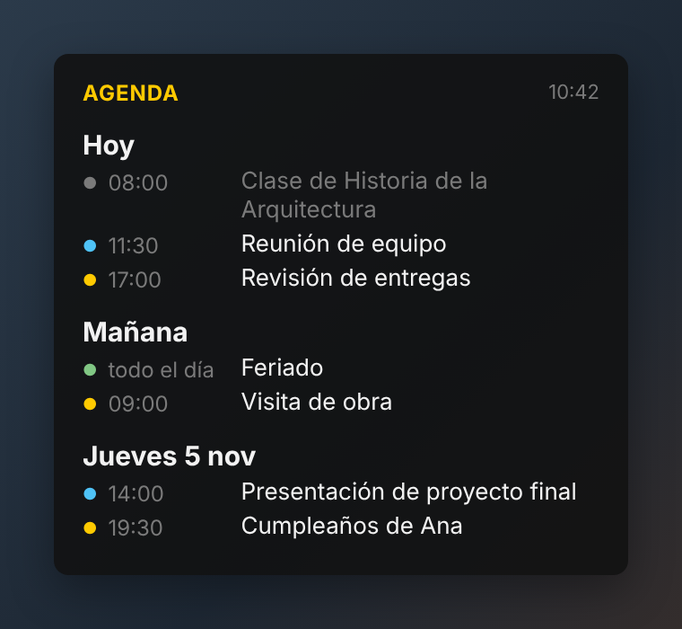

# Agenda

Widget de escritorio para **Windows 11** que muestra los próximos eventos de tus calendarios de **Google Calendar**. Gratuito y de código abierto.

<p align="center"></p>

## Qué hace

- Ventana flotante, sin bordes y semitransparente, que queda **detrás de tus aplicaciones**.
- **Varios calendarios**, cada uno con su color. Los mostrás, ocultás o renombrás cuando quieras.
- Agrupa los eventos por día ("Hoy", "Mañana", "Jueves 5 nov") y atenúa los que ya pasaron.
- **Ctrl + Alt + A** lo trae al frente; repetirlo lo devuelve al fondo.
- Alto máximo ajustable; si los eventos no entran, se desplazan con una barra fina, estilo teléfono.
- Se actualiza solo cada 10 minutos y muestra la hora de la última actualización. Recuerda su posición. Opacidad y días a mostrar regulables.
- **Sin conexión, sigue mostrando tu agenda:** usa los últimos eventos descargados y avisa claramente desde cuándo no se actualiza.
- Se adapta a la escala de Windows (125 %, 150 %) y vuelve a la pantalla si cambia la configuración de monitores.
- Solo lectura: nunca modifica tus calendarios.

## Instalación

1. Descargá **`Agenda-Setup.exe`** desde [Releases](../../releases/latest).
2. Ejecutalo una sola vez y esperá: algunos antivirus lo revisan antes de abrirlo y puede tardar unos segundos. Si Windows muestra *"Windows protegió su PC"*, tocá **Más información → Ejecutar de todos modos**. Aparece porque la app no tiene firma digital paga; el código completo está en este repositorio.
3. Durante la instalación podés elegir que Agenda se abra al iniciar Windows.

> **Antivirus:** algunos, como Avast (*CyberCapture*), analizan durante un minuto los programas nuevos sin firma digital y muestran *"Suspicious file detected"*. Es un análisis preventivo, no una detección: al terminar, Agenda se instala y abre con normalidad.

No necesita Python ni permisos de administrador.

## Agregar tus calendarios

Agenda lee cada calendario por su **dirección secreta en formato iCal**, sin pedir tu contraseña de Google.

1. Abrí [Google Calendar](https://calendar.google.com) en el navegador.
2. Engranaje ⚙ → **Configuración**.
3. En la columna izquierda, bajo *Configuración de mis calendarios*, elegí un calendario.
4. Bajá hasta **Integrar el calendario** y copiá la **Dirección secreta en formato iCal**.
5. En Agenda: clic derecho → **Administrar calendarios** → pegala → **Agregar calendario**.

Repetí con cada calendario que quieras ver.

> **Importante:** esa dirección permite leer tu calendario. No la compartas. Si se filtra, podés restablecerla desde la misma pantalla de Google.

## Privacidad

Agenda guarda las direcciones secretas y la copia local de tus eventos **cifradas con la protección de datos de Windows (DPAPI)**: solo tu usuario de Windows, en esa computadora, puede leerlas.

- Protege frente a otros usuarios del equipo, copias de respaldo y archivos compartidos por error. No protege frente a un programa malicioso que se ejecute en tu propia sesión.
- La configuración no se puede copiar a otra computadora: en cada una se agregan los calendarios.
- Si un administrador restablece tu contraseña de Windows, o se vuelve a crear tu usuario, Windows puede perder la clave. Agenda marca con ⚠ los calendarios que no puede leer: quitalos y volvé a agregarlos. Cambiar la contraseña de la forma habitual no afecta.
- Al actualizar desde una versión anterior, la configuración existente se cifra automáticamente.

## Uso

| Acción | Cómo |
|---|---|
| Mover | Arrastrar con el mouse |
| Menú | Clic derecho |
| Mostrar u ocultar calendarios | Clic derecho → Calendarios |
| Renombrar o quitar | Clic derecho → Administrar calendarios |
| Traer al frente | Ctrl + Alt + A |
| Cambiar el alto | Arrastrar el borde inferior |
| Desplazar la lista | Rueda del mouse o barra fina de la derecha |
| Actualizar ahora | Clic en la hora de arriba a la derecha |

**Bueno saber:** Google puede tardar varias horas en publicar los cambios en la dirección iCal, así que un evento recién creado quizá no aparezca enseguida.

La configuración se guarda en `%APPDATA%\Agenda\config.json` y la copia local de los eventos, en `%LOCALAPPDATA%\Agenda\cache`.

## Compilar desde el código

Requiere [Python 3](https://www.python.org/downloads/) y, para el instalador, [Inno Setup 6](https://jrsoftware.org/isdl.php).

```
compilar.bat
```

Genera la app en `dist\Agenda\` y el instalador en `instalador\Agenda-Setup.exe`.

## Licencia

[MIT](LICENSE) © 2026 Javier Benítez · Arquitectuna
